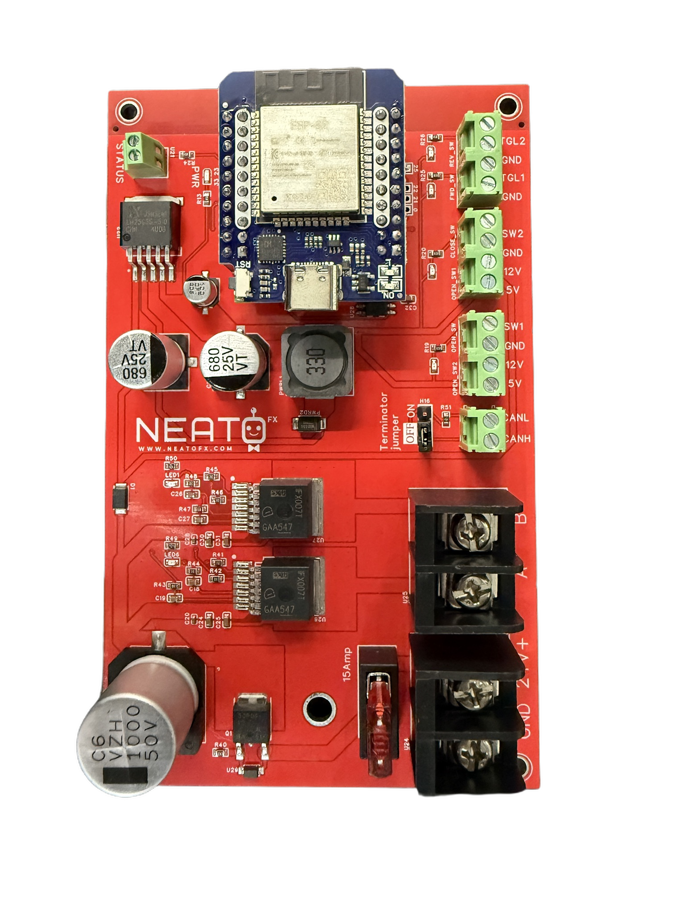

# NeatoFx Motor - WiFi Motor & Actuator Controller

The NeatoFx Motor is a professional-grade WiFi-enabled motor controller for interactive attractions, escape rooms, and entertainment systems. One board, five behaviors chosen in the web UI: hold-to-run DC motor, 240VAC controller, timed linear actuator, encoder-tracked winch, and dual pulse/air-valve firing. The 24V board adds CAN bus networking so multiple controllers coordinate as a game.



## Table of Contents

- [Overview](#overview)
- [Boards (main files)](#boards-main-files)
- [Motor Type](#motor-type)
- [Hardware](#hardware)
- [Getting Started](#getting-started)
- [Web UI](#web-ui)
- [CAN Bus (24V board)](#can-bus-24v-board)
- [Safety Features](#safety-features)
- [Troubleshooting](#troubleshooting)

## Overview

The NeatoFx Motor drives:

- **Animated Props**: Moving arms, rotating heads, opening mechanisms
- **Door/Gate Actuators**: Automated entry and exit systems
- **Linear Actuators**: Timed extend / retract cycles for interactive displays
- **Winches & Hoists**: Encoder-tracked position with soft limits
- **Air Valves / Solenoids**: Timed pulse firing for pneumatic effects
- **240VAC Motor Controllers**: Dry-contact style direction control
- **Multi-Station Games**: CAN-networked controllers gated by a central game display (24V board)

## Boards (main files)

There is one main per board. Each builds ONE binary for every unit of that board, with its own hostname and firmware update channel:

| Main | Board | CAN | SW1 | Hostname | Update channel |
|---|---|---|---|---|---|
| `main_24v.yaml` | Rev 4.3 24V (`boards/rev4_3_24v.yaml`) | yes (GPIO4/5) | GPIO25 | `motor-24v-xxxxxx` | `firmware/motor/` |
| `main_12v.yaml` | Rev 3.3 12V (`boards/rev3_3_12v.yaml`) | no | GPIO4 | `motor-12v-xxxxxx` | `firmware/motor-12v/` |

The Rev 4.3 and Rev 3.3 boards are otherwise identical; their shared I/O is `boards/common/board_io.yaml` and everything else they share is `base.yaml`. The 24V board keeps the `motor` update channel that earlier firmware used.

The original **Rev 3.0 12V** board is built from `main_12v.yaml` by switching its board line to `boards/rev3_0_12v.yaml`. It has a single momentary **TOGGLE** button (GPIO14) in place of Input 1 / Input 2 and its status LED on GPIO22; everything else matches Rev 3.3. With one input it is a **Linear Actuator** only — Motor Type is fixed and hidden; choose **Cycle**, or **Toggle** for a door (each button press is the next move). SW1 / SW2 are the actuator's limits.

## Motor Type

What the controller does is the **Motor Type** select in the web UI — every drive is compiled into every build, and the choice is saved on the device and kept across firmware updates. Pick the type that matches what is wired to Output A / B before running anything; changing it stops the motor.

| Motor Type | Input 1 / Input 2 | Release | SW1 / SW2 | Package |
|---|---|---|---|---|
| **DC Motor** (default) | hold: ramp forward / reverse | stop | limit switches | `drive_dc.yaml` |
| **AC Controller** | hold: ground Output A / B (240VAC controller M1 / M2) | stop | limit switches | `drive_ac.yaml` |
| **Linear Actuator** | Input 1 runs a timed extend → retract cycle; Input 2 cancels and jogs in reverse | stop (the cycle keeps running) | latched limit switches | `linear_act.yaml` |
| **Winch** | hold: reel out / reel in | stop | **encoder** (two Hall sensors) | `winch.yaml` |
| **Pulse** | press: Output A / B on for Pulse Time | nothing | unused | `pulse.yaml` |

The select and the routing live in `boards/common/drives.yaml`.

### DC Motor / AC Controller
Hold-to-run: hold Input 1 to run forward, Input 2 to run reverse, release to stop. SW1/SW2 are hard stops for their direction. DC ramps PWM up to **Motor Speed** over **Ramp to Speed**. AC turns the two H-bridge halves into dry contacts for an external 240VAC controller: Input 1 grounds Output A (M1) and floats Output B (M2), Input 2 the opposite, release floats both.

### Linear Actuator
A single trigger on Input 1 (or **Run Cycle**) ramps the actuator out for **Extend Time**, then reverses for **Retract Time**, then drops the output. SW1 kills the forward output for the rest of the extend phase and SW2 the reverse output for the retract phase — the clock keeps running, so a cycle always takes the same time. Input 2 (or **Cancel Cycle**) cancels and jogs in reverse.

**Linear Mode = Toggle** (for doors): each Input 1 trigger makes **one** move, alternating — extend, then on the next trigger retract — for its Extend / Retract Time (or until its limit switch), then stays put until the next trigger. Input 2 / Stop stops a move; the next Input 1 still goes the other way. The next direction is saved across restarts. The web UI's Stop button cancels a cycle or a move in either mode.

### Winch
A winch is the standard motor with a position encoder **instead of limit switches**: the two Hall sensors connect to the SW1 / SW2 inputs, and every edge is one count (8 magnets → 32 counts / rev). There is no home switch — GPIO26 stays the status LED.

1. Jog the winch fully in and press **Set Home Here** (position 0). Until home is set it only runs at **Slow Speed**, with no soft limits.
2. Reel out to full length, measure the cable, enter it in **Measured Max Length** and press **Set Max Length**.
3. From then on reel-in stops at home, reel-out stops at the max length, and it slows to **Slow Speed** within **Slow Zone** counts of either end. **Limit Override** bypasses both soft limits for recalibrating.

Position and calibration are saved, so they survive a reboot (the worm gear holds position unpowered). The winch stops itself if either output's current stays above **Max Current**.

### Pulse
Two independent outputs for air valves or solenoids: Input 1 fires Output A, Input 2 fires Output B, each for **Pulse Time** (default 100 ms). Releasing the input does not cut a pulse short.

## Hardware

### Board Specifications
- **MCU**: ESP32 (Wemos D1 Mini32)
- **Motor Driver**: 2× BTN8962TA H-bridge
- **Max Current**: 8A per direction with over-current trip (threshold configurable)
- **Operating Voltage**: 12V or 24V board
- **WiFi**: 802.11 b/g/n (2.4GHz only)
- **CAN**: SN65HVD232 transceiver, 250 kbps (24V board)

### Pin Map (Rev 3.3 12V / Rev 4.3 24V; Rev 3.0 differences noted)

| Pin | Function | Notes |
|-----|----------|-------|
| GPIO19 | R_PWM | Output A: forward / reel-out / valve A |
| GPIO18 | L_PWM | Output B: reverse / reel-in / valve B |
| GPIO17 | R_EN | Right H-bridge enable |
| GPIO16 | L_EN | Left H-bridge enable |
| GPIO34 | R_IS | Output A current sense (ADC) |
| GPIO35 | L_IS | Output B current sense (ADC) |
| GPIO32 | Input 1 (TGL1) | Rev 3.0: GPIO14 (single TOGGLE button) |
| GPIO27 | Input 2 (TGL2) | Rev 3.0: none |
| GPIO25 / GPIO4 | SW1 | 24V board / 12V board — limit switch, or winch encoder |
| GPIO13 | SW2 | Limit switch, or winch encoder |
| GPIO4 / GPIO5 | CAN RX / TX | 24V board only |
| GPIO26 | Status LED | Every motor type (Rev 3.0: GPIO22) |

## Getting Started

1. Place your WiFi credentials in `secrets.yaml` (one directory above this repo).
   See [`_shared/secrets.template.yaml`](../../_shared/secrets.template.yaml).

2. Flash the main for your board:
   ```bash
   esphome run Controllers/NeatoMotor/main_24v.yaml     # or main_12v.yaml
   ```
   To change the network mode, un-comment one `config:` line in that main (Home Assistant is the shipping default).

3. Open the web UI — `http://motor-24v-xxxxxx.local` / the unit's IP, or on the setup hotspot `http://192.168.4.1` — and set the **Motor Type** and the **Source Address**.

## Web UI

The custom page (no internet needed) has:
- **Motor** — live status plus Reverse / Stop / Forward buttons (named for the Motor Type: Reel In / Out, Retract / Run Cycle, Fire A / B)
- **Motor Type**, **Drive** (speed, ramp, NC limit switches, max current), and a card for the selected type only (**Linear Actuator**, **Winch**, **Pulse**)
- **Source Address** — the unit's number (0–238); the CAN node address on the 24V board
- **Diagnostics** — Log Level, inputs, switches, currents, network, and a live **Device Log**
- **Reset** and **Firmware Update** (install a `.bin` from the page)

## CAN Bus (24V board)

250 kbps, 11-bit IDs, node address = the **Source Address** (0–238, set in the web UI). Frame map:

| ID | Dir | Purpose |
|----|-----|---------|
| `0x100` | RX | Game gate + settings broadcast (all nodes, ~5 Hz): active flag, motor ramp, speed, max current, game timer |
| `0x200+id` | TX | Status frame: inputs, limit switches, output states, CAN-control and armed flags |
| `0x300+id` | TX | Motor telemetry |
| `0x400+id` | RX | Remote drive commands (always honored, even while game-inactive) |

A single 0x100 broadcast from the game display gates every controller on the bus. Settings ride in the same frame, so a rebooted node re-syncs automatically.

## Safety Features

- **Boot-safe H-bridge**: outputs are forced off at the earliest boot priority, before GPIO init completes — the motor cannot twitch on power-up
- **Over-current trip**: current sense on both directions, ~200 ms debounce to ride out start-up inrush — via CAN on the 24V board (every type), and built into the Winch type on both boards
- **Hold-to-run**: releasing an input always stops the motor
- **Limit switches**: hard stops per direction; NO or NC wiring supported (NC mode toggle)
- **Game gating (CAN)**: joysticks are disarmed until the game controller says otherwise

### Recommendations
1. Always install limit switches at mechanical travel limits
2. Use wire gauge rated for your stall current
3. Test emergency stop (release-to-stop) before deploying
4. Use a power supply with over-current protection

## Troubleshooting

### Motor Won't Start
1. **Power** — verify motor supply voltage at the board input
2. **Wiring** — verify motor terminals on the H-bridge outputs; test the motor directly on a bench supply
3. **Game-gated** — on the 24V board (CAN), joysticks are ignored until a game-active (0x100) frame arrives; check the logs for "game inactive"
4. **Limit switch already tripped** — the input for that direction is blocked; check SW1/SW2 state in the web UI, and check the NC Mode toggle matches your switch wiring

### Motor Stops Immediately (Stall Trip)
1. Check for mechanical jams — move the mechanism by hand
2. Load too high for the motor — reduce load or raise the max-current setting
3. Start-up inrush tripping — increase Ramp to Speed

### Winch Position Wrong
1. Jog fully in and press **Set Home Here** again; then redo **Set Max Length**
2. The encoder's two Hall sensors go on the SW1 / SW2 inputs; check **Encoder Count** changes while the winch moves
3. Re-run calibration after any mechanical change to the reel

### Limit Switch Not Stopping the Motor
1. Verify wiring pulls the GPIO to GND when triggered (NO mode) — or enable **NC Mode** for normally-closed switches
2. SW1 = GPIO25 (24V board) or GPIO4 (12V board), SW2 = GPIO13. Limit switches only act in DC / AC / Linear types
3. Mechanically verify the mechanism actually reaches and presses the switch

### WiFi Issues
1. Verify SSID and password in `secrets.yaml`
2. ESP32 is 2.4GHz only
3. If unreachable, connect to the `motor-24v-xxxxxx` / `motor-12v-xxxxxx` setup hotspot and reconfigure

## Support

For issues or questions:
1. Check this README troubleshooting section
2. Set **Log Level** to DEBUG in the web UI (Diagnostics) and watch the Device Log
3. Verify all mechanical components move freely
4. Review ESPHome documentation at esphome.io
5. Contact NeatoFx support with device logs

Made by the NeatoFx Team
*Last updated: October 2026*
